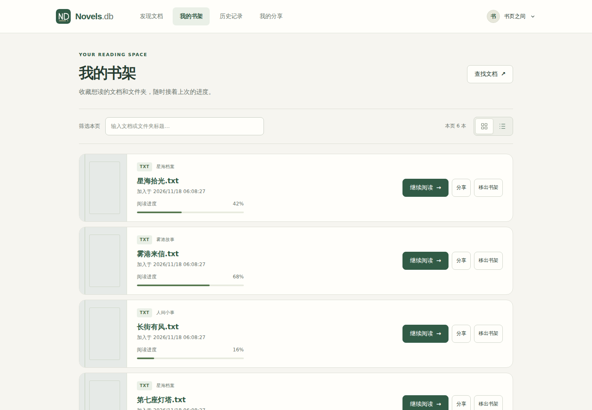
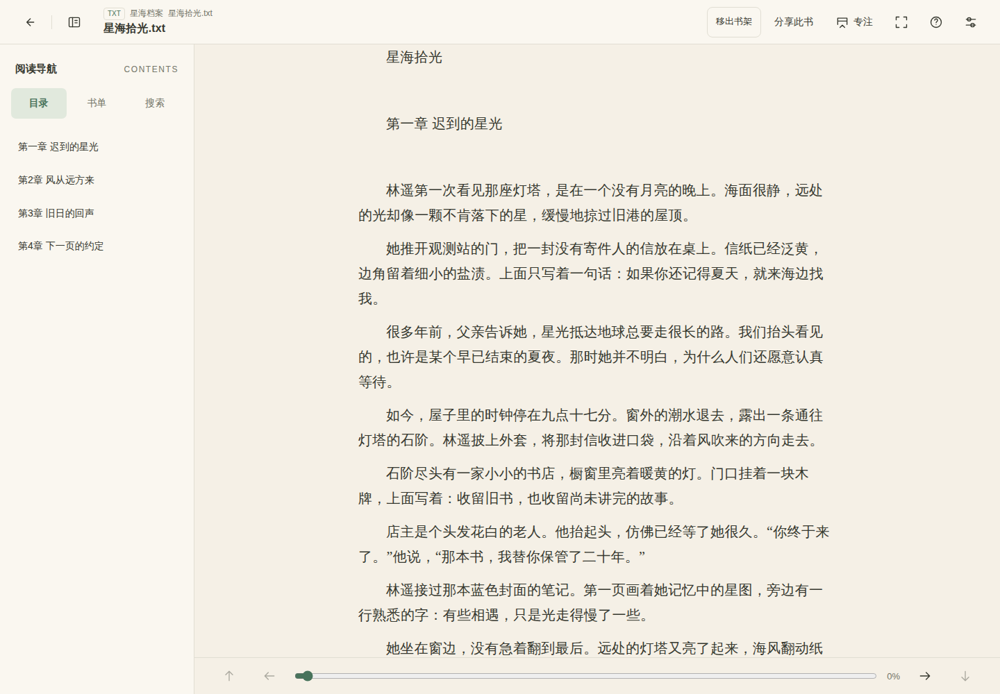

<div align="center">
  
  <h1>Novels.db <sup>ND</sup></h1>
  <p><strong>A full-text search reader for very large novel libraries</strong></p>
  <p><a href="README.md">简体中文</a> · <strong>English</strong></p>
  <p><a href="#quick-start">Quick start</a> · <a href="docs/README.md">Documentation</a> · <a href="CONTRIBUTING.md">Contributing</a> · <a href="https://github.com/uiharuayako/Novels.db/issues">Issues</a></p>
</div>

**Novels.db (ND)** is based primarily on **[recoll-webui](https://framagit.org/medoc92/recollwebui)**, with [Recoll](https://www.recoll.org/) providing indexing and search. Remember a line of dialogue but not the title? Search the text, open the matching novel, save it to your bookshelf and resume where you left off.

The project targets search and reading across very large novel libraries. Capacity and query performance depend on the collection, Recoll index and deployment resources. ND connects to an existing index; the operator manages document collection, index creation and updates.


## From search to reading

| Feature | What it provides |
| --- | --- |
| Full-text search | Recoll query syntax, phrases, directory/date filters, match snippets and CSV / JSON export. |
| Discovery | Continue recent books, revisit search recommendations and explore daily picks. |
| Personal bookshelf | Save books or folders, switch grid/list views and resume reading. |
| Browser reader | Continuous reading, contents, in-book search, typography controls and focus mode. |
| Accounts and sync | Per-account history, progress and preferences, with explicit choices for conflicting positions. |
| Sharing | Expiring links to books or folders, revocable by the owner. |

### Actual application screenshots

These are real application pages using a disposable Recoll index, isolated accounts and original demo stories. They contain no personal library data. The interface is currently primarily Simplified Chinese, with desktop and mobile layouts.

**Find a line inside a story.** Search results keep snippets, filters and reading actions together.


**Keep your next read close.** The bookshelf stores favorites and synced progress.



**Open a book and keep reading.** Contents and continuous text share a warm paper reading canvas.



## How it works

```text
Novel files → Recoll index → Novels.db → Search and reading in the browser
                              └─ SQLite: accounts, bookshelf, history and progress
```

The backend uses Python, Bottle, Waitress and SQLite. Reader assets ship with the repository and require no runtime CDN downloads. All accounts share the operator's configured library while keeping separate personal records. Anyone holding a public share link can read its contents without signing in; configure sharing to match the library's access policy.

Readable formats include TXT, Markdown, HTML, XML, MHTML, EPUB, MOBI, AZW / AZW3, FB2, CHM, DOCX, PDF, CBZ, CBR, CBT and CB7. Layout and positioning support vary by format. CHM requires `7z`; text search in scanned PDFs requires an OCR text layer. Folder reading scans up to 1,000 readable files. Recoll container `ipath` entries support preview/download rather than direct reading. Moved files need to be found again.

## Quick start

Requirements: Linux, Python 3, a system installation of Recoll including `recollindex` and its Python bindings, and a modern browser. Recoll is a system dependency, not a pip package.

### 1. Build your library index

Create `recoll.conf` in your own Recoll configuration directory and point `topdirs` to your novels:

```ini
# /path/to/recoll-config/recoll.conf
topdirs = /path/to/novels
```

Then build the index:

```bash
recollindex -c /path/to/recoll-config
```

The service's OS account must be able to read the documents, configuration and index. Schedule index updates separately.

### 2. Install and initialize accounts

```bash
git clone https://github.com/uiharuayako/Novels.db.git
cd Novels.db
python3 -m venv --system-site-packages .venv
. .venv/bin/activate
python -m pip install -r requirements.txt
python -c "from recoll import recoll, rclextract, rclconfig"

export RECOLL_WEBUI_DB_PATH="$HOME/.local/share/recoll-webui/app.sqlite3"
python manage.py init --username admin
```

The initializer prompts for a 15–128 character password. On first login, change it and sign in again. Keep the database in a private persistent directory outside the source tree, static files and library. Use the same database path for all service and maintenance commands. Initialization also creates a `.secret` signing key beside the database. An uninitialized deployment returns a setup error instead of opening the library anonymously.

### 3. Start reading

```bash
python webui-standalone.py -c /path/to/recoll-config
```

Open [http://127.0.0.1:8080/](http://127.0.0.1:8080/). Use `-a` for the bind address, `-p` for the port and `-t` for worker threads. Run `python webui-standalone.py --help` for options.

For HTTPS behind a reverse proxy, deploy `webui-wsgi.py` and configure both the WSGI server and the application's `RECOLL_WEBUI_TRUSTED_PROXIES` to trust that proxy. The WSGI server must pass `wsgi.url_scheme=https` to the application. Subpath deployments use WSGI `SCRIPT_NAME`. See the [systemd guide](README-systemd.rst) in English or the [operations guide](docs/operations.rst) in Chinese.

## Maintenance and documentation

| Guide | Contents |
| --- | --- |
| [Documentation index](docs/README.md) | Deployment, reader development and maintainer references |
| [Operations guide](docs/operations.rst) | Full setup, configuration, format constraints, proxies and maintenance (中文) |
| [Account and reading data](docs/accounts-and-history.md) | Registration, permissions, retention and recovery (中文) |
| [systemd deployment](README-systemd.rst) | Service account, persistent storage and scheduled cleanup (English) |
| [Contributing](CONTRIBUTING.md) | Development setup, tests, issues and pull requests (中文 / English) |
| [Origins and licensing](docs/third-party.md) | Upstream projects and bundled dependency notices (中文 / English) |

Run maintenance as the service's OS account with the same database path:

```bash
python manage.py create-user reader --display-name Reader
python manage.py reset-password admin --enable --admin
python manage.py cleanup
python manage.py backup /private/backups/recoll-backup.sqlite3
```

The backup destination must not already exist. Back up the signing key `.secret` and registration settings `.registration.json` separately, together with your Recoll configuration, index and original documents. Before restoration, stop **all** standalone / WSGI workers:

```bash
python manage.py restore /private/backups/recoll-backup.sqlite3 --workers-stopped
```

Back up and stop workers before an upgrade. Registration is closed by default and can be managed by an administrator; no email address is required. Search history, recent reading and progress sync can be controlled separately. Bookshelf records protect their associated progress from normal retention cleanup. See the linked guides for retention periods and access rules.

## Contributions welcome

PRs, bug reports, documentation fixes, translations and reader improvements are welcome. You can participate in English or Chinese, including for your first contribution. Read [CONTRIBUTING.md](CONTRIBUTING.md), and discuss larger changes in an issue first.

## Acknowledgments

This project is based primarily on **[medoc92/recollwebui](https://framagit.org/medoc92/recollwebui)**, which originated from [koniu/recoll-webui](https://github.com/koniu/recoll-webui). Thanks to [Recoll](https://www.recoll.org/) for the search engine, [Koodo Reader / Kookit](https://github.com/koodo-reader/koodo-reader) and [Mozilla PDF.js](https://github.com/mozilla/pdf.js) for reader runtimes, and the reader projects referenced in our design notes. See [origins and licensing](docs/third-party.md).
