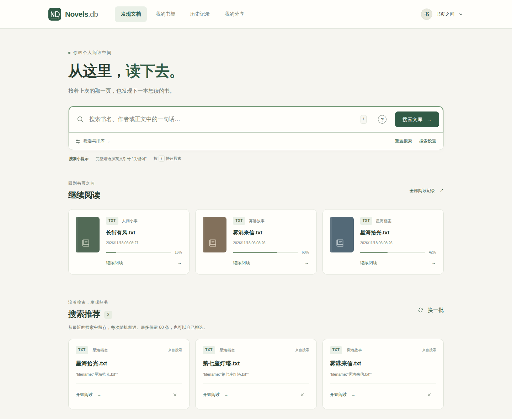
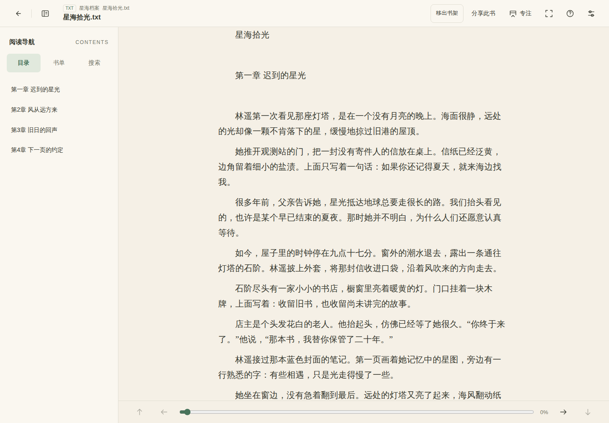

<div align="center">
  
  <h1>Novels.db <sup>ND</sup></h1>
  <p><strong>面向超大规模小说数据库的全文检索阅读器</strong></p>
  <p><strong>简体中文</strong> · <a href="README.en.md">English</a></p>
  <p><a href="#快速开始">快速开始</a> · <a href="docs/README.md">文档</a> · <a href="CONTRIBUTING.md">参与贡献</a> · <a href="https://github.com/uiharuayako/Novels.db/issues">反馈问题</a></p>
</div>

**Novels.db（ND）** 主要基于 [recoll-webui](https://framagit.org/medoc92/recollwebui)，由 [Recoll](https://www.recoll.org/) 提供全文索引与检索。记得一句对白，却忘了书名？搜索正文，打开命中的小说，加入书架，下次接着上次的位置读。

项目面向超大规模小说库的检索与阅读，实际容量和查询表现取决于文库、Recoll 索引与部署资源。应用连接已有索引；文档采集、索引创建与更新由部署者管理。



## 从检索到阅读

| 能力 | 你可以做什么 |
| --- | --- |
| 全文检索 | 使用 Recoll 查询语法、短语、目录与日期筛选；查看命中摘要，导出 CSV / JSON。 |
| 文库发现 | 回到最近阅读的位置，从搜索推荐和每日推荐中发现下一本书。 |
| 个人书架 | 收藏单本或整个文件夹，在网格、列表之间切换，继续上次的阅读。 |
| 连续阅读 | 在浏览器中阅读 TXT、EPUB、PDF 等格式，使用目录、书内搜索、排版设置与专注模式。 |
| 账号与同步 | 按账号保存书架、历史、阅读位置和偏好；多设备位置冲突可手动选择。 |
| 链接分享 | 分享单本或文件夹，设置有效期，也可随时取消。 |

### 看看实际界面

以下截图来自本应用的真实运行页面，使用临时 Recoll 索引、独立账号和原创演示小说，不包含个人文库数据。界面目前以简体中文为主，适配桌面和手机。

**搜到故事里的那一句。** 命中摘要、目录筛选与阅读入口放在一起。


**把想读的书留下来。** 书架保存收藏与阅读进度。


**打开书，接着读。** 目录、连续正文和阅读设置都在浏览器中。



## 工作方式

```text
小说文件 → Recoll 索引 → Novels.db → 浏览器搜索与阅读
                         └─ SQLite：账号、书架、历史与进度
```

后端使用 Python、Bottle、Waitress 和 SQLite；阅读资源随仓库提供，运行时无需从 CDN 下载。所有账号共享部署者配置的文库，各自保留个人记录。公开分享链接持有人无需登录即可读取被分享内容，请按文库的访问范围配置分享权限。

支持 TXT、Markdown、HTML、XML、MHTML、EPUB、MOBI、AZW / AZW3、FB2、CHM、DOCX、PDF，以及 CBZ / CBR / CBT / CB7。不同格式的排版与定位能力有所差异；CHM 需要 `7z`，扫描 PDF 的文字搜索需要 OCR 文本层。文件夹阅读最多扫描 1,000 本可读文件。容器内条目的预览和下载见[运维指南](docs/operations.rst)。

达到 2 MiB 的 HTML、HTM、XHTML 和 Markdown 首次打开时会在服务端分段并缓存。浏览器只加载当前位置附近的正文，保留图文排版、目录、书内跳转和全文搜索。达到同一大小的 DOCX 使用分段正文模式，可下载原件查看完整排版。

## 快速开始

**生产部署推荐 Docker Compose，NAS 可通过 Dockge 管理。** 宿主机需要 Docker Engine、Compose 和已有 Recoll 配置、索引与原文档；无需安装宿主机 Python。原生 Python 步骤见后面的[开发者运行](#开发者运行原生-python)。

容器连接**已有索引，不要为部署 WebUI 重建索引**；容器也不会运行 `recollindex`。镜像使用 Debian 发行版的 Recoll 与系统 Python，以 `--system-site-packages` 虚拟环境安装现有 `requirements.txt`，包含 CHM 所需的 `7z` 和 Word 预览所需的 LibreOffice Writer。默认身份为数值 `1000:1000`；可调整 UID/GID，但 UID 必须非零且能读取挂载文件。

### 1. 准备 Docker / Dockge 目录与配置

NAS 推荐将 `compose.yaml` 和 `.env` 放在 **`/mnt/user/appdata/dockge/stacks/recoll-webui/`**。将仓库中的 `compose.yaml` 保存到该目录，后续 Docker 命令均在此目录执行。目录准备和目标恢复示例使用 NAS 的 root 管理终端；普通 Linux 主机先运行 `sudo -i`。

```bash
STACK=/mnt/user/appdata/dockge/stacks/recoll-webui
install -d -m 755 "$STACK" "$STACK/recoll-config"
cd "$STACK"
```

只将源端的 **`recoll.conf`** 复制到 `$STACK/recoll-config/`；如实际使用了自定义 `fields`、`mimemap`、`mimeconf` 等配置，也只复制这些文件。**不要拷贝整个 Recoll 配置目录**，不需要其中的索引、`aspdict`、日志或备份。索引直接挂载现有目录，配置中引用的其他自定义文件也须在容器内可读。

配置、原文档、索引都只读挂载；SQLite、`.secret`、`.registration.json` 及锁文件单独保存在宿主机本地持久目录，**不要放在 SMB/NFS 文库中**。根文件系统只读，转换缓存写入 `/tmp`。

下面以现有小库为默认示例。容器内保留原 VM 绝对路径，NAS 只调整挂载源。文库身份包含 Recoll 配置目录，文件身份和阅读进度依赖原绝对路径：

| 内容 | 容器内固定路径 | VM 默认宿主路径 | NAS 小库源路径 |
| --- | --- | --- | --- |
| Recoll 配置 | `/home/uiharu/.recoll-novel` | 同左 | `/mnt/user/appdata/dockge/stacks/recoll-webui/recoll-config` |
| 小说原文 | `/mnt/share/migusuper/fastFolder/Novel` | 同左 | `/mnt/migusuper/fastFolder/Novel` |
| Recoll 索引 | `/mnt/share/migusuper/fastFolder/re_index` | 同左 | `/mnt/migusuper/fastFolder/re_index` |
| 应用数据 | `/var/lib/recoll-webui` | 同左 | `/mnt/cache/appdata/recoll-webui/state`（本地磁盘） |

保留 `recoll.conf` 中的 `topdirs = /mnt/share/migusuper/fastFolder/Novel` 和 `dbdir = /mnt/share/migusuper/fastFolder/re_index`。在 stack 目录创建 `.env`：

```dotenv
RECOLL_WEBUI_IMAGE=ghcr.io/uiharuayako/novels.db:latest
RECOLL_WEBUI_UID=1000
RECOLL_WEBUI_GID=1000
RECOLL_WEBUI_BIND=127.0.0.1
RECOLL_WEBUI_PORT=8080
RECOLL_CONFIG_SOURCE=/mnt/user/appdata/dockge/stacks/recoll-webui/recoll-config
RECOLL_LIBRARY_SOURCE=/mnt/migusuper/fastFolder/Novel
RECOLL_INDEX_SOURCE=/mnt/migusuper/fastFolder/re_index
RECOLL_STATE_SOURCE=/mnt/cache/appdata/recoll-webui/state
```

其他安装按实际存储调整源路径；`state` 必须是本地文件系统。所有源目录应预先存在，Compose 不会自动创建空目录。确保选定 UID/GID 可遍历配置、索引与文库目录并读取配置文件；需要额外组权限时配置 `group_add`，不要递归修改文库所有权。

```bash
# 在部署主机的管理终端执行，UID/GID 与 .env 一致。
install -d -o 1000 -g 1000 -m 700 /mnt/cache/appdata/recoll-webui/state
chmod 755 "$STACK/recoll-config"
chmod 644 "$STACK/recoll-config/recoll.conf"
docker compose config --quiet
```

自定义配置文件也需允许所选 UID 读取。符号链接解析后的路径须在容器中可见；其他部署需相应调整固定目标，保持原有文库身份。

### 2. 选择镜像并启动

`compose.yaml` 默认使用 `ghcr.io/uiharuayako/novels.db:latest`。**使用已成功发布且有权拉取的镜像版本**；自行首次发布时先完成 GHCR 发布工作流，或按[本地构建](#本地构建与-ghcr-ci)生成镜像。私有包需先 `docker login ghcr.io`，公开拉取需将包设为 public。选择 GHCR 版本时执行：

```bash
docker compose pull
```

仅全新部署初始化账号；已有账号数据先执行下一节的迁移恢复，跳过 `init`：

```bash
docker compose run --rm webui python manage.py init --username admin
docker compose up -d
```

初始化要求输入 15–128 个字符的密码，首次登录后须改密并重新登录。打开 [http://127.0.0.1:8080/](http://127.0.0.1:8080/)。远程访问可通过宿主机反向代理或 SSH 隧道；直接提供局域网访问时将 `RECOLL_WEBUI_BIND` 改为部署主机地址。HTTPS 反向代理使用 `RECOLL_WEBUI_TRUSTED_PROXIES`、`RECOLL_WEBUI_PROXY_SCHEME=https`，只信任实际代理地址。升级时先备份，然后 `docker compose stop webui`、`docker compose pull`、`docker compose up -d`；重建容器会保留宿主机 `state`。

### 迁移、备份与恢复

演练使用临时目标目录与独立端口，保留原服务。正式切换时才停止源服务的所有工作进程，并重新导出最终快照，避免漏掉演练后的书架或进度变更。以下命令在源主机以原服务的系统账号、数据库路径和 Python 环境执行：

```bash
set -eu
SOURCE_DB=/actual/service/path/app.sqlite3
BACKUP_DIR=$(mktemp -d)
.venv/bin/python manage.py --db "$SOURCE_DB" backup "$BACKUP_DIR/app.sqlite3"
install -m 600 "$SOURCE_DB.secret" "$BACKUP_DIR/app.sqlite3.secret"
if [ -f "$SOURCE_DB.registration.json" ]; then
  install -m 600 "$SOURCE_DB.registration.json" "$BACKUP_DIR/app.sqlite3.registration.json"
else
  printf '%s\n' '源端没有注册配置文件；恢复时使用缺省关闭状态。'
fi
```

将快照目录安全传到目标主机的 `state/restore/`，保留上述文件名。数据库必须通过 `manage.py backup` 导出，不能直接复制运行中的 SQLite 文件；签名密钥和注册配置不在数据库备份内。

下面在**目标主机的 root 管理终端**执行，普通 Linux 主机先 `sudo -i`；`state/restore` 可能是其他数值 UID 所有的 `0700` 目录，不能用普通操作者的 `if [ -f ... ]` 判断文件是否存在。下例显式复制注册配置，无法读取时立即报错。**仅当源端明确没有该文件时，略过第二条 `install`，并将目标原有的 `.registration.json` 移到挂载目录外备份**，保留缺省关闭状态。恢复已有目标前先备份目标数据库及两个配套文件，并确保所有目标工作进程已停止：

```bash
set -eu
cd /mnt/user/appdata/dockge/stacks/recoll-webui
STATE=/mnt/cache/appdata/recoll-webui/state
docker compose stop webui
install -o 1000 -g 1000 -m 600 "$STATE/restore/app.sqlite3.secret" "$STATE/app.sqlite3.secret"
install -o 1000 -g 1000 -m 600 "$STATE/restore/app.sqlite3.registration.json" "$STATE/app.sqlite3.registration.json"
chown -R 1000:1000 "$STATE"
chmod 700 "$STATE" "$STATE/restore"
docker compose run --rm webui python manage.py restore /var/lib/recoll-webui/restore/app.sqlite3 --workers-stopped
docker compose up -d
```

UID/GID 在命令和 `.env` 中保持一致。恢复保留账号、书架、历史和进度，会撤销旧会话，需要重新登录；不要在恢复前执行 `init` 生成替代密钥。索引保持原样挂载，维护仍由原有外部任务负责。

容器内备份可直接写入持久目录，目的文件必须尚不存在：

```bash
docker compose exec webui python manage.py backup /var/lib/recoll-webui/backup-before-upgrade.sqlite3
```

另行保存同目录的 `app.sqlite3.secret` 和 `app.sqlite3.registration.json`（如存在），以及 Recoll 配置、索引和原文档。

### 本地构建与 GHCR CI

生产推荐使用 GHCR 发布镜像；本地构建在源码目录执行，并在后续 Compose 命令中持续使用同一镜像选择：

```bash
docker build -t recoll-webui:local .
export RECOLL_WEBUI_IMAGE=recoll-webui:local
cd /mnt/user/appdata/dockge/stacks/recoll-webui
docker compose run --rm webui python -c 'from recoll import recoll, rclextract, rclconfig'
# 按快速开始初始化或恢复数据后再启动。
docker compose up -d
```

通过 Dockge 启动本地镜像时，将 stack 的 `.env` 中 `RECOLL_WEBUI_IMAGE` 也改为 `recoll-webui:local`，不要执行 GHCR 拉取。`.github/workflows/container.yml` 在 PR 上只构建并检查运行环境；默认分支（`master`）和 Git tag 的 push 在检查通过后发布 GHCR，其他分支不发布。默认分支产生 `latest`，tag 保留原名，每次发布也有 `sha-…` 标签。生产可用 `RECOLL_WEBUI_IMAGE` 固定 tag 或 digest。发布需允许工作流写入 Packages；构建上下文仅包含应用代码、运行依赖清单和随附静态资源。

## 开发者运行（原生 Python）

本节供开发、调试使用；生产部署优先采用上面的 Docker 流程。需要 Linux、Python 3 和系统安装的 Recoll Python 扩展。Recoll 不是 pip 依赖，解释器必须能导入系统扩展。复用已有配置和索引；**已有索引不要重建**。尚无索引时，先按[运维指南](docs/operations.rst)为独立测试文库建索引，索引更新仍由部署者管理。

```bash
git clone https://github.com/uiharuayako/Novels.db.git
cd Novels.db
python3 -m venv --system-site-packages .venv
. .venv/bin/activate
python -m pip install -r requirements.txt
python -c "from recoll import recoll, rclextract, rclconfig"

export RECOLL_WEBUI_DB_PATH="$HOME/.local/share/recoll-webui/app.sqlite3"
# 仅新建开发账号库时执行；既有账号数据按迁移步骤恢复。
python manage.py init --username admin
python webui-standalone.py -c /path/to/recoll-config
```

数据库应放在源码、静态资源和文库之外的私有持久目录中。打开 [http://127.0.0.1:8080/](http://127.0.0.1:8080/)。`-a` 指定监听地址，`-p` 指定端口，`-t` 指定线程数；完整选项见 `python webui-standalone.py --help`。原生 WSGI、HTTPS 代理及 `SCRIPT_NAME` 子路径配置见[运维指南](docs/operations.rst)和 [systemd 示例](README-systemd.rst)。

## 文档与维护

| 文档 | 内容 |
| --- | --- |
| [文档导航](docs/README.md) | 部署、阅读、开发与维护者参考资料 |
| [运维与功能指南](docs/operations.rst) | 完整安装、配置、格式限制、代理与数据维护 |
| [账号与阅读数据](docs/accounts-and-history.md) | 权限、注册、保留规则、备份与恢复 |
| [systemd 部署](README-systemd.rst) | 长期运行、服务账号与定时清理 |
| [贡献指南](CONTRIBUTING.md) | 开发环境、测试、Issue 与 PR |
| [来源与许可说明](docs/third-party.md) | 上游关系及随附依赖的许可信息 |

升级前备份并停止应用工作进程。账号数据使用 `python manage.py backup /private/backups/recoll-backup.sqlite3` 备份，**签名密钥 `.secret`、注册配置 `.registration.json`、Recoll 配置、索引和原文档需另行备份**。恢复步骤与完整命令见[运维指南](docs/operations.rst)。

## 欢迎参与

欢迎提交 **PR、问题反馈、文档修正、翻译与阅读体验改进**。中文、English 都可以；第一次贡献也欢迎。从 [CONTRIBUTING.md](CONTRIBUTING.md) 开始，大幅改动建议先开 Issue 沟通目标和范围。

## 致谢

本项目主要基于 **[medoc92/recollwebui](https://framagit.org/medoc92/recollwebui)**，该项目更早源自 [koniu/recoll-webui](https://github.com/koniu/recoll-webui)。感谢 [Recoll](https://www.recoll.org/) 提供全文检索引擎，[Koodo Reader / Kookit](https://github.com/koodo-reader/koodo-reader) 与 [Mozilla PDF.js](https://github.com/mozilla/pdf.js) 提供阅读运行时，以及阅读器设计参考项目。详见[来源与许可说明](docs/third-party.md)。
