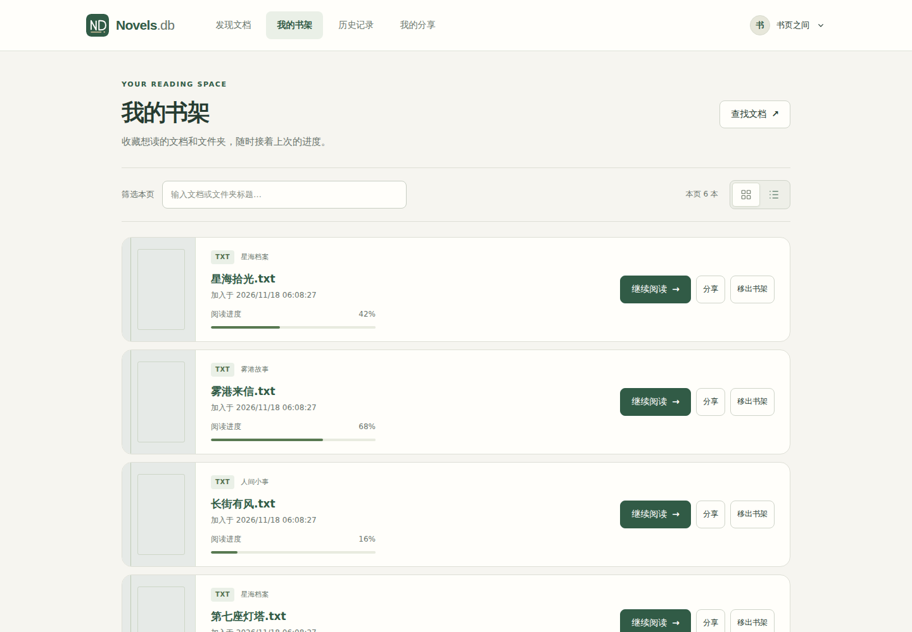

<div align="center">
  
  <h1>Novels.db <sup>ND</sup></h1>
  <p><strong>面向超大规模小说数据库的全文检索阅读器</strong></p>
  <p><strong>简体中文</strong> · <a href="README.en.md">English</a></p>
  <p><a href="#快速开始">快速开始</a> · <a href="docs/README.md">文档</a> · <a href="CONTRIBUTING.md">参与贡献</a> · <a href="https://github.com/uiharuayako/Novels.db/issues">反馈问题</a></p>
</div>

**Novels.db（ND）** 主要基于 [recoll-webui](https://framagit.org/medoc92/recollwebui)，由 [Recoll](https://www.recoll.org/) 提供全文索引与检索。记得一句对白，却忘了书名？搜索正文，打开命中的小说，加入书架，下次接着上次的位置读。

项目面向超大规模小说库的检索与阅读，实际容量和查询表现取决于文库、Recoll 索引与部署资源。应用连接已有索引；文档采集、索引创建与更新由部署者管理。


## 从检索到阅读

| 能力 | 你可以做什么 |
| --- | --- |
| 全文检索 | 使用 Recoll 查询语法、短语、目录与日期筛选；查看命中摘要，导出 CSV / JSON。 |
| 文库发现 | 回到最近阅读的位置，从搜索推荐和每日推荐中发现下一本书。 |
| 个人书架 | 收藏单本或整个文件夹，在网格、列表之间切换，继续上次的阅读。 |
| 连续阅读 | 在浏览器中阅读 TXT、EPUB、PDF 等格式，使用目录、书内搜索、排版设置与专注模式。 |
| 账号与同步 | 按账号保存书架、历史、阅读位置和偏好；多设备位置冲突可手动选择。 |
| 链接分享 | 分享单本或文件夹，设置有效期，也可随时取消。 |

### 看看实际界面

以下截图来自本应用的真实运行页面，使用临时 Recoll 索引、独立账号和原创演示小说，不包含个人文库数据。界面目前以简体中文为主，适配桌面和手机。

**搜到故事里的那一句。** 命中摘要、目录筛选与阅读入口放在一起。


**把想读的书留下来。** 书架保存收藏与阅读进度。



**打开书，接着读。** 目录、连续正文和阅读设置都在浏览器中。


## 工作方式

```text
小说文件 → Recoll 索引 → Novels.db → 浏览器搜索与阅读
                         └─ SQLite：账号、书架、历史与进度
```

后端使用 Python、Bottle、Waitress 和 SQLite；阅读资源随仓库提供，运行时无需从 CDN 下载。所有账号共享部署者配置的文库，各自保留个人记录。公开分享链接持有人无需登录即可读取被分享内容，请按文库的访问范围配置分享权限。

支持 TXT、Markdown、HTML、XML、MHTML、EPUB、MOBI、AZW / AZW3、FB2、CHM、DOCX、PDF，以及 CBZ / CBR / CBT / CB7。不同格式的排版与定位能力有所差异；CHM 需要 `7z`，扫描 PDF 的文字搜索需要 OCR 文本层。文件夹阅读最多扫描 1,000 本可读文件。容器内条目的预览和下载见[运维指南](docs/operations.rst)。

## 快速开始

需要 Linux、Python 3、系统安装的 Recoll（含 `recollindex` 及 Python 扩展）和现代浏览器。Recoll 不是 pip 依赖，解释器必须能导入它的系统扩展。

### 1. 准备文库索引

在自己的 Recoll 配置目录中创建 `recoll.conf`，将 `topdirs` 指向小说目录，例如：

```ini
# /path/to/recoll-config/recoll.conf
topdirs = /path/to/novels
```

然后建立索引：

```bash
recollindex -c /path/to/recoll-config
```

运行服务的系统账号需要能够读取文档、配置和索引。后续更新索引仍由部署者安排。

### 2. 安装与初始化

```bash
git clone https://github.com/uiharuayako/Novels.db.git
cd Novels.db
python3 -m venv --system-site-packages .venv
. .venv/bin/activate
python -m pip install -r requirements.txt
python -c "from recoll import recoll, rclextract, rclconfig"

export RECOLL_WEBUI_DB_PATH="$HOME/.local/share/recoll-webui/app.sqlite3"
python manage.py init --username admin
```

初始化会交互式要求输入 15–128 个字符的密码；首次登录后必须改密并重新登录。请将数据库保存在源码、静态资源和文库之外的私有持久目录中，后续命令和服务始终使用同一数据库路径。

### 3. 启动阅读

```bash
python webui-standalone.py -c /path/to/recoll-config
```

打开 [http://127.0.0.1:8080/](http://127.0.0.1:8080/)。可用 `-a` 指定监听地址、`-p` 指定端口、`-t` 指定线程数。完整选项见 `python webui-standalone.py --help`。

对外提供 HTTPS 时，通过 `webui-wsgi.py` 部署，并在 WSGI 服务器和应用的 `RECOLL_WEBUI_TRUSTED_PROXIES` 中配置可信代理，让应用收到正确的 `wsgi.url_scheme=https`。子路径挂载使用 WSGI `SCRIPT_NAME`。[完整运维指南](docs/operations.rst) · [systemd 示例](README-systemd.rst)

## 文档与维护

| 文档 | 内容 |
| --- | --- |
| [文档导航](docs/README.md) | 部署、阅读、开发与维护者参考资料 |
| [运维与功能指南](docs/operations.rst) | 完整安装、配置、格式限制、代理与数据维护 |
| [账号与阅读数据](docs/accounts-and-history.md) | 权限、注册、保留规则、备份与恢复 |
| [systemd 部署](README-systemd.rst) | 长期运行、服务账号与定时清理 |
| [贡献指南](CONTRIBUTING.md) | 开发环境、测试、Issue 与 PR |
| [来源与许可说明](docs/third-party.md) | 上游关系及随附依赖的许可信息 |

升级前备份并停止应用工作进程。账号数据使用 `python manage.py backup /private/backups/recoll-backup.sqlite3` 备份，**签名密钥 `.secret`、注册配置 `.registration.json`、Recoll 配置、索引和原文档需另行备份**。恢复步骤与完整命令见[运维指南](docs/operations.rst)。

## 欢迎参与

欢迎提交 **PR、问题反馈、文档修正、翻译与阅读体验改进**。中文、English 都可以；第一次贡献也欢迎。从 [CONTRIBUTING.md](CONTRIBUTING.md) 开始，大幅改动建议先开 Issue 沟通目标和范围。

## 致谢

本项目主要基于 **[medoc92/recollwebui](https://framagit.org/medoc92/recollwebui)**，该项目更早源自 [koniu/recoll-webui](https://github.com/koniu/recoll-webui)。感谢 [Recoll](https://www.recoll.org/) 提供全文检索引擎，[Koodo Reader / Kookit](https://github.com/koodo-reader/koodo-reader) 与 [Mozilla PDF.js](https://github.com/mozilla/pdf.js) 提供阅读运行时，以及阅读器设计参考项目。详见[来源与许可说明](docs/third-party.md)。
